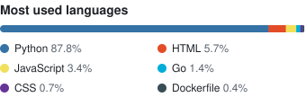
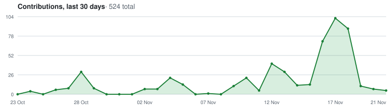

### Hi, I'm David 👋

I build self-hosted apps for the things I do at home. Work stuff is at [@davidquinney](https://github.com/davidquinney).

**Apps**
- **[GT7 Copilot](https://github.com/quinneydavid/gt7-copilot):** AI Companion for Gran Turismo 7
- **[OpenBrisket](https://github.com/quinneydavid/openbrisket):** BBQ as Code
- **[Hub Warmer](https://github.com/quinneydavid/hub-warmer):** Plex Cache Warmer
- **[SG Miles Advisor](https://github.com/quinneydavid/sg-miles-advisor):** Singapore Credit Cards Advisor
- **[maybank-manchester-united-bot](https://github.com/quinneydavid/maybank-manchester-united-bot):** Telegram bot for Manchester United Matches

**Infrastructure as code**
- **[terraform-provider-firewalla](https://github.com/quinneydavid/terraform-provider-firewalla):** OpenTofu/Terraform provider for Firewalla
- **[Mass-Clone-VMs](https://github.com/quinneydavid/Mass-Clone-VMs):** Mass clone and power on VMs via vCenter using VAAI.

<picture>
  <source media="(prefers-color-scheme: dark)" srcset="https://raw.githubusercontent.com/quinneydavid/quinneydavid/output/top-langs-dark.svg" />
  
</picture>

<picture>
  <source media="(prefers-color-scheme: dark)" srcset="https://raw.githubusercontent.com/quinneydavid/quinneydavid/output/activity-graph-dark.svg" />
  
</picture>

**Recent activity**
<!--START_SECTION:activity-->
1. 🔒 Closed issue [#603](https://github.com/agregarr/agregarr/issues/603) in [agregarr/agregarr](https://github.com/agregarr/agregarr)
2. 🗣 Commented on [#603](https://github.com/agregarr/agregarr/issues/603#issuecomment-7156041948) in [agregarr/agregarr](https://github.com/agregarr/agregarr)
3. 🗣 Commented on [#645](https://github.com/agregarr/agregarr/pull/645#issuecomment-7156041212) in [agregarr/agregarr](https://github.com/agregarr/agregarr)
4. ❌ Closed PR [#645](https://github.com/agregarr/agregarr/pull/645) in [agregarr/agregarr](https://github.com/agregarr/agregarr)
5. ❌ Closed PR [#642](https://github.com/agregarr/agregarr/pull/642) in [agregarr/agregarr](https://github.com/agregarr/agregarr)
<!--END_SECTION:activity-->
