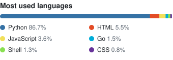
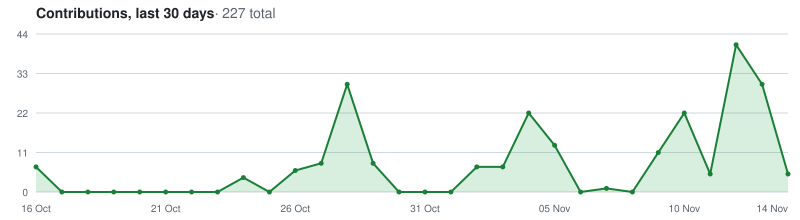

### Hi, I'm David 👋

Homelab as code, Kubernetes on Talos, and self-hosted tools. Work stuff is at [@davidquinney](https://github.com/davidquinney).

**Projects**
- **[terraform-provider-firewalla](https://github.com/quinneydavid/terraform-provider-firewalla):** OpenTofu/Terraform provider for Firewalla's MSP API
- **[talos](https://github.com/quinneydavid/talos):** Talos Linux Kubernetes homelab
- **[Mass-Clone-VMs](https://github.com/quinneydavid/Mass-Clone-VMs):** mass clone and power on VMs via vCenter using VAAI
- **[maybank-manchester-united-bot](https://github.com/quinneydavid/maybank-manchester-united-bot):** Telegram bot for Man United match alerts and Maybank card spending tips

<picture>
  <source media="(prefers-color-scheme: dark)" srcset="https://raw.githubusercontent.com/quinneydavid/quinneydavid/output/github-snake-dark.svg" />
  
</picture>

<picture>
  <source media="(prefers-color-scheme: dark)" srcset="https://raw.githubusercontent.com/quinneydavid/quinneydavid/output/top-langs-dark.svg" />
  
</picture>

<picture>
  <source media="(prefers-color-scheme: dark)" srcset="https://raw.githubusercontent.com/quinneydavid/quinneydavid/output/activity-graph-dark.svg" />
  
</picture>

**Recent activity**
<!--START_SECTION:activity-->
1. 💪 Opened PR [#643](https://github.com/agregarr/agregarr/pull/643) in [agregarr/agregarr](https://github.com/agregarr/agregarr)
2. 💪 Opened PR [#642](https://github.com/agregarr/agregarr/pull/642) in [agregarr/agregarr](https://github.com/agregarr/agregarr)
3. ℹ️ Labeled issue [#6009](https://github.com/opentofu/registry/issues/6009) in [opentofu/registry](https://github.com/opentofu/registry)
4. ℹ️ Labeled issue [#6009](https://github.com/opentofu/registry/issues/6009) in [opentofu/registry](https://github.com/opentofu/registry)
5. ❗ Opened issue [#6009](https://github.com/opentofu/registry/issues/6009) in [opentofu/registry](https://github.com/opentofu/registry)
<!--END_SECTION:activity-->
